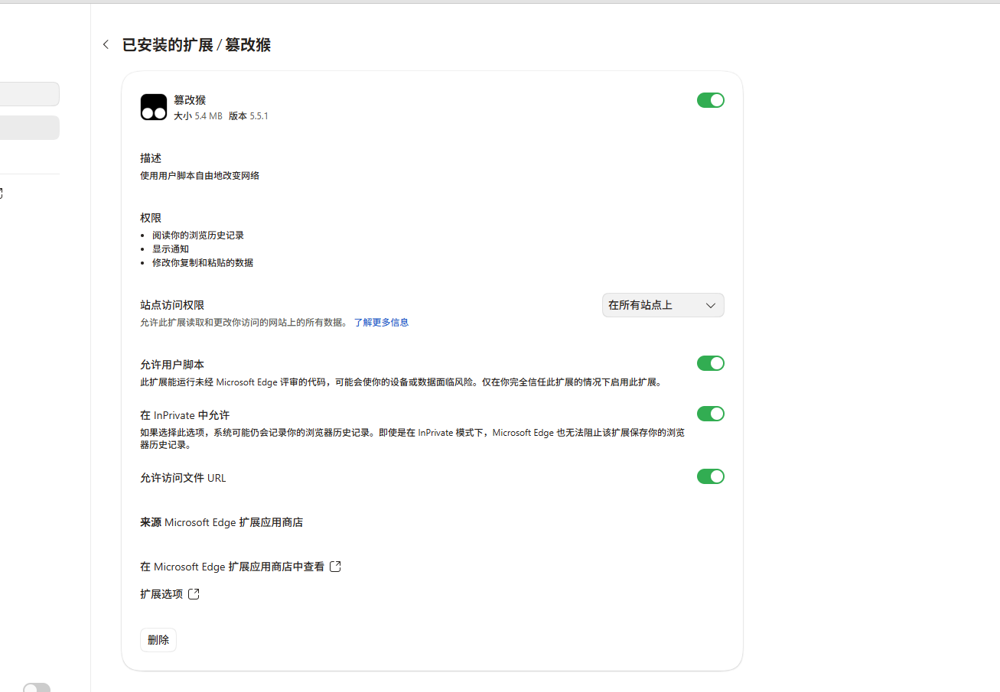
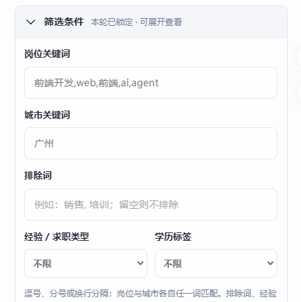

# 安装与首次使用

适用：电脑端 Chrome / Microsoft Edge，安装 Tampermonkey（油猴）后使用 BOSS 网页版。新手无需运行命令，也不用修改代码中的变量。

## 1. 安装油猴插件

打开 [Tampermonkey 官方网站](https://www.tampermonkey.net/)，选择当前浏览器对应的扩展商店入口并安装。安装后可在浏览器工具栏“扩展”菜单中找到油猴。

## 2. 开启“允许用户脚本”

打开浏览器的扩展管理页面：Edge 是 `edge://extensions`，Chrome 是 `chrome://extensions`。找到 Tampermonkey，进入“详细信息”，打开**允许用户脚本**。



浏览器版本不同，开关名称与位置可能不同。如果找不到“允许用户脚本”，查看 [Tampermonkey 官方执行权限说明](https://www.tampermonkey.net/faq.php#Q209)，按当前版本要求检查开发者模式或首次执行授权。扩展也需要允许访问 BOSS 网站。

图中的“InPrivate 中允许”“允许访问文件 URL”不是本脚本的必需项，不用照着全部开启。

## 3. 添加新脚本，粘贴完整代码

1. 点击浏览器工具栏的油猴图标，选择“添加新脚本 / 创建新脚本”。
2. 全选并删除编辑器中的默认示例。
3. 在 GitHub 仓库中打开根目录 [boss-helper.user.js](../boss-helper.user.js)，点击 **Raw** 查看原始代码，再全选复制。
4. 回到油猴编辑器粘贴，按 `Ctrl+S` 保存。
5. 确认这份脚本处于启用状态；旧版助手请停用，避免重复运行。

从 `// ==UserScript==` 一直到文件最后的 `})();` 都要复制，不要连同 Markdown 的三个反引号一起复制。也可以先从仓库下载 ZIP，解压后用文本编辑器打开同一个 `.user.js` 文件复制。

## 4. 在手机 BOSS App 设置默认招呼语

登录与电脑端**同一个 BOSS 账户**，找到 App 提供的招呼语、自定义招呼语或沟通设置，按自己的真实情况修改并保存。

不同 App 版本和账户提供的入口、可用选项可能不同，以自己的页面为准。若账户没有自定义入口，就使用网站当前可用的默认招呼方式；脚本不会替账户开通该功能。可以先通过一条人工沟通确认实际展示内容。

示例，仅供按真实资料改写：

> 您好，我对贵公司的岗位很感兴趣，想进一步了解岗位要求和工作内容，方便沟通吗？

**区别：**列表里的“立即沟通”使用 BOSS 自身的招呼机制。助手设置里的“默认沟通话术”用于在聊天页手动启动后的介绍，两者独立。

## 5. 打开 BOSS，展开助手

在电脑打开 [BOSS 网页版](https://www.zhipin.com/)，登录后进入岗位列表，刷新一次。

面板通常会直接显示。如果之前最小化了，点击页面右下角的**纸飞机图标**恢复：


如果图标和面板都没有出现，按 [常见问题](FAQ.md)检查油猴、脚本、站点访问权限及“允许用户脚本”。

## 6. 设置筛选，英文逗号隔开



直接复制下面的格式，再改成自己的求职条件：

```text
岗位关键词：前端开发,Web,AI,Agent
城市关键词：广州,深圳
排除词：销售,培训
```

多个关键词使用键盘上的**英文逗号 `,`**，不是空格。城市留空代表不限，排除词留空代表不排除。经验和学历默认“不限”，需要时再选择。

## 7. 先预览，再启动

1. 点击“预览当前列表匹配”，查看哪些岗位匹配、哪些被排除。
2. 确认符合预期后，点击“启动投递”。
3. 顶部会显示当前步骤、岗位和倒计时。批次休息时无需连续点击启动。
4. 需要结束时点击“立即停止”。要修改条件，先停止再编辑。


“新沟通”和“旧会话”是按钮点击数，不是送达证明。到达上限会停止；跨路径进入聊天页后，需要在新页面手动启动。首次使用可在设置中把每轮上限调小，先核对结果。

## 8. 可选：编辑聊天话术

只使用列表沟通可以跳过这一步。若要在聊天页启动，点击齿轮打开设置，将 `[目标岗位]`、`[相关技能/经验]`、`[到岗时间]` 替换成真实内容并保存。未替换占位符时，脚本会提示编辑，不会把模板直接发出去。

AI 默认关闭，不影响列表沟通。需要时再按 [配置说明](CONFIGURATION.md)填写接口和真实求职资料。
